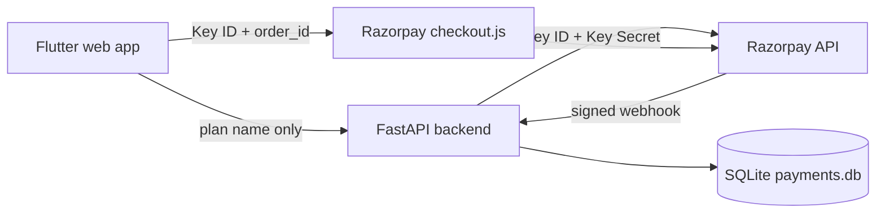
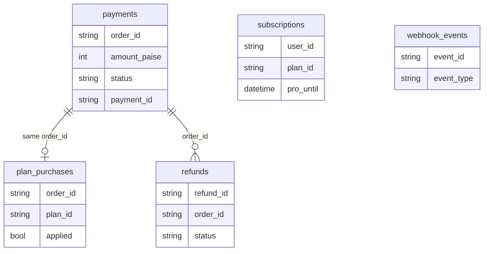
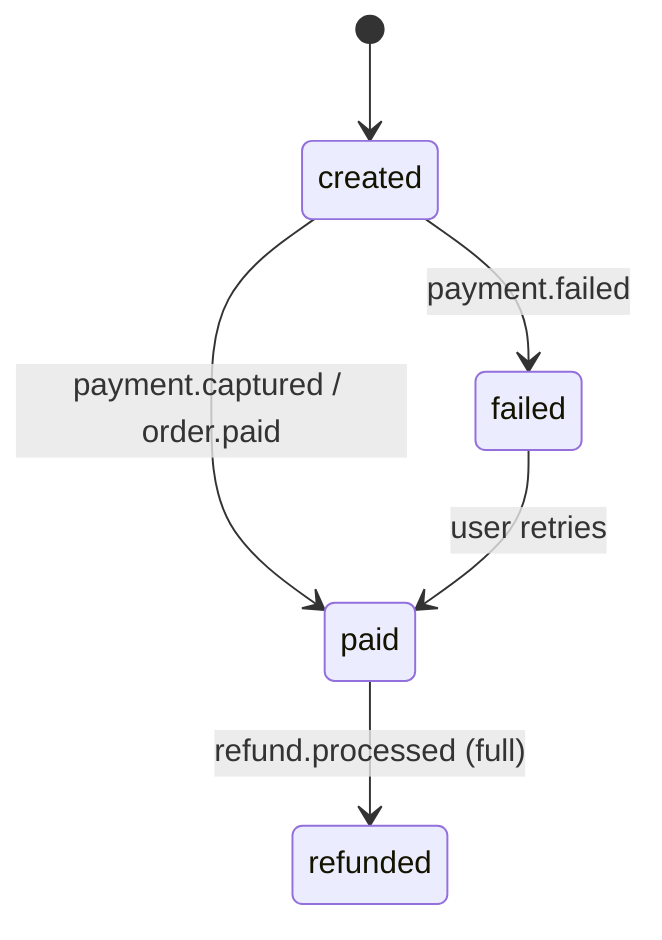
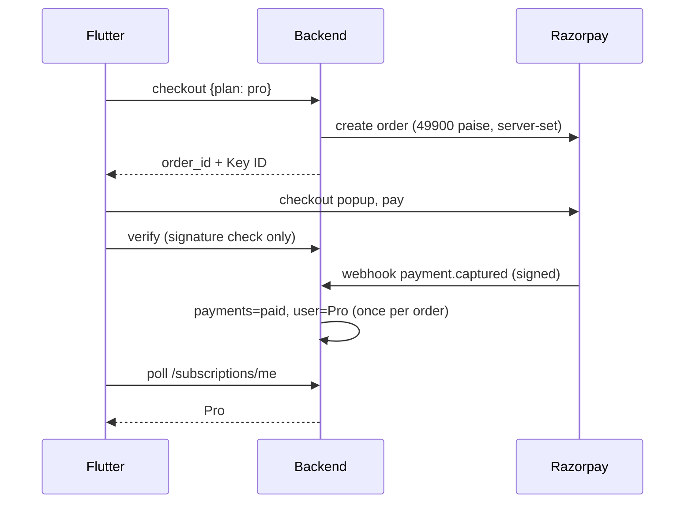
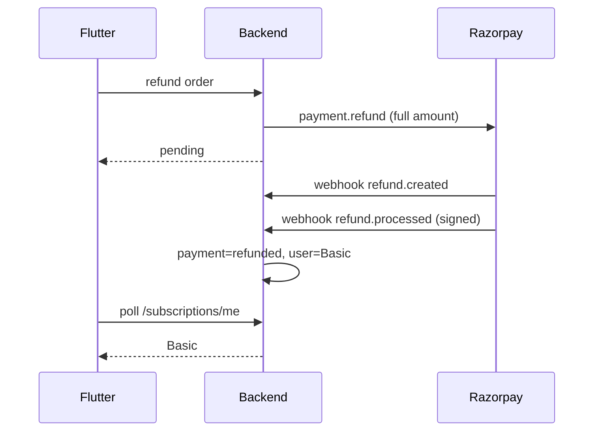

# Session log: everything built and why

A written record of the whole session, so you can refer back without the chat.

## 1. Where we are

| Area | State |
|---|---|
| Backend (FastAPI + SQLite) | Done: orders, signature verify, webhooks, plans, subscriptions, refunds |
| Flutter web app | Done: subscription page, upgrade, refund button |
| Real test payments | Worked (upgrade to Pro, refund) |
| Open problem | A refund webhook did not arrive, so one refund is stuck on `pending` (see section 9) |
| Not done | Reconcile step, GCP deployment (team lead said not now), live mode |

Commits (oldest first): project skeleton, backend setup, create-order, verify, Flutter checkout, webhook, SQLite + webhook-only status, subscriptions, subscription page, refunds, refund button.

## 2. Core ideas (from lesson 01)

- A **payment gateway** (Razorpay) talks to banks for you.
- **Order** = a bill for an exact amount, created on Razorpay by the backend. **Payment** = the customer's attempt to pay it.
- Amounts are in **paise** (Rs 499 = 49900).
- **Key ID** is public (app may hold it). **Key Secret** is private (backend `.env` only).
- **Signature** = HMAC-SHA256 fingerprint that proves a message came from Razorpay.
- The app is never trusted to say "paid".

## 3. Architecture


Look at: the app sends only a plan name. The server decides the price. Status changes come from the webhook arrow.

## 4. Backend files (`backend/app/`)

| File | Purpose |
|---|---|
| `main.py` | Creates the app, CORS, includes routers, creates tables |
| `config.py` | Reads `.env` (keys, webhook secret, database URL) |
| `db.py` | SQLAlchemy engine and session |
| `payments/schemas.py` | Request/response shapes |
| `payments/service.py` | Talks to Razorpay, signature checks |
| `payments/repository.py` | All database reads/writes for payments and refunds |
| `payments/models.py` | Tables: `payments`, `webhook_events`, `refunds` |
| `payments/router.py` | `/payments/*` endpoints and the webhook |
| `subscriptions/plans.py` | Plan catalog (Basic free, Pro Rs 499 for 30 days) |
| `subscriptions/models.py` | Tables: `subscriptions`, `plan_purchases` |
| `subscriptions/repository.py` | Upgrade, revoke, expiry |
| `subscriptions/router.py` | `/subscriptions/me`, `/subscriptions/checkout` |

## 5. Endpoints

| Method and path | What it does |
|---|---|
| `GET /health` | Alive check |
| `POST /payments/create-order` | Creates an order from a rupee amount |
| `POST /payments/verify` | Checks the checkout signature only. Does not change status. |
| `GET /payments/status/{order_id}` | Reads status from the database |
| `POST /payments/{order_id}/refund` | Starts a full refund (409 if not paid or already refunded) |
| `POST /payments/webhook` | Receives Razorpay events. The only thing that changes status. |
| `GET /subscriptions/me` | Current plan, expiry, refundable order, refund status |
| `POST /subscriptions/checkout` | Creates an order for a plan. Body is `{"plan_id": "pro"}`. |

## 6. Database



Payment status moves:

Refund status: `pending` then `processed` or `failed`. `processed` is final.

## 7. Flows

**Upgrade to Pro**


**Refund**


## 8. Rules the code follows (and why)

- **Server sets prices.** If the app sent the amount, a user could change Rs 499 to Rs 1.
- **Webhook signature uses the raw body.** Parsing it first changes the bytes and breaks the check.
- **Webhook secret differs from the Key Secret.** You chose it yourself in the dashboard.
- **Duplicate events are ignored** using the unique `event_id`. Razorpay can send an event more than once.
- **Amount must match** before an order is marked paid.
- **`paid` can only become `refunded`.** A late `payment.failed` cannot undo a payment.
- **Partial refunds** (made in the dashboard) do not downgrade the user. Only a full refund does.
- **`.env` and `payments.db` are git-ignored.** The Key Secret is never in Flutter code.
- **`razorpay_flutter` does not support web.** The web app uses Razorpay's `checkout.js` instead.

## 9. Open problem: missed refund webhook

- Refund `rfnd_U1B7VqOWQ16ulQ` was created at Razorpay and shows `processed` there.
- Our server never received its `refund.created` or `refund.processed` webhook, so our database still says `pending` and the plan is still Pro.
- The first refund worked: both webhooks arrived within 2 seconds. The tunnel and server were healthy, so the cause is not known from here. The Razorpay dashboard webhook section may show a failed delivery.
- **Option 1 (suggested): reconcile.** The backend asks Razorpay for the status of anything pending for more than ~20 seconds, then applies the same rules as the webhook. This relaxes "webhook only", so it needs your approval.
- **Option 2:** fix only this record by hand, keep the design webhook-only.

## 10. Problems met along the way and their causes

| Problem | Cause |
|---|---|
| A long command was blocked | The tool blocks commands that start a server. Run servers in separate calls. |
| Expiry check crashed with "naive and aware datetimes" | SQLite drops timezones. Stored values are now treated as UTC. |
| Server did not restart after `pkill` | The `pkill` pattern also matched its own shell. Use the port's PID instead. |
| "Confirming with server..." never appeared | The webhook arrived before the app's first status check, so there was nothing to wait for. |
| Cloudflare tunnel URL changes on every restart | It is a free temporary tunnel. The dashboard webhook URL must be updated each time. |

## 11. How to run

```
# Terminal 1: backend
cd ~/razorpay/backend && source .venv/bin/activate && uvicorn app.main:app --port 8000

# Terminal 2: tunnel (for webhooks)
~/.local/bin/cloudflared tunnel --url http://localhost:8000
# then set the dashboard webhook URL to <tunnel URL>/payments/webhook

# Terminal 3: app
cd ~/razorpay/mobile && flutter run -d chrome
```
Test card: `4111 1111 1111 1111`, any future expiry, any CVV. Test UPI: `success@razorpay` or `failure@razorpay`.

Dashboard webhook events needed: `payment.captured`, `payment.failed`, `order.paid`, `refund.created`, `refund.processed`, `refund.failed`.

## 12. Ideas parked for later

- **GCP deployment (Cloud Run)** to replace the tunnel. Your team lead said not now. SQLite would need Cloud SQL, because Cloud Run's disk is temporary.
- **Login.** The demo uses one fixed user, `demo-user`.
- **Auto-renewing subscriptions** using Razorpay's Subscriptions API.
- **Going live:** KYC, live keys, HTTPS, restricted CORS.
