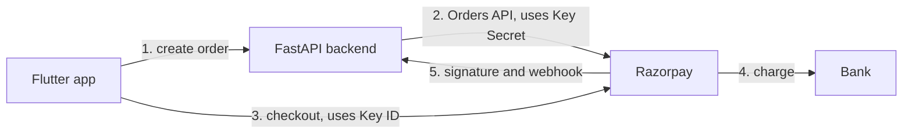
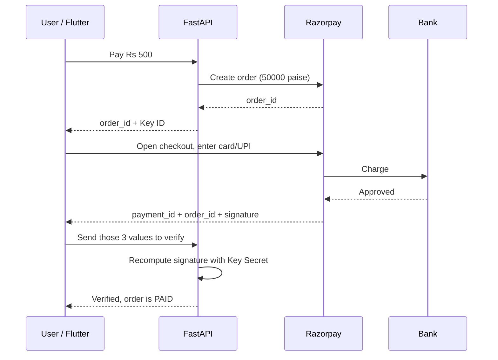

# 01 - The Big Picture

## 1. Goal
Understand what a payment gateway is, who talks to whom in a payment, and why your app can never be trusted to say "payment succeeded" by itself.

## 2. Simple explanation
A **payment gateway** is like the card machine at a shop counter, but for the internet. You (the shop) do not talk to the customer's bank directly. The gateway (Razorpay) does that safely for you.

Analogy: a restaurant.
- Customer = the Flutter app user.
- Waiter taking the order = your FastAPI backend (it writes the bill amount).
- Card machine company = Razorpay.
- Bank = the customer's bank, which actually moves the money.
- The customer saying "I paid, trust me" = the app claiming success. You would not let them leave until the machine's receipt is confirmed.

Jargon:
| Term | Meaning |
|---|---|
| Gateway | Service that safely carries payment details between you and banks |
| Order | A bill created on Razorpay's server for an exact amount |
| Payment | The customer's actual attempt to pay for an order |
| Signature | A secret-based fingerprint proving a message really came from Razorpay |
| Paise | Smallest INR unit. Rs 1 = 100 paise. Razorpay amounts are in paise |

## 3. Diagrams

### Block diagram

Look at: the Key Secret only appears on the backend arrow. The app only ever sees the public Key ID.

### Sequence diagram of the full journey

Look at: the last three steps. Only the backend decides "paid".

## 4. Why the app can't be trusted
The app runs on the user's phone. Anyone can modify it or fake network calls. If the app told the server "payment succeeded", a cheater could send that message without paying.

| Who says "paid" | Trustworthy? | Why |
|---|---|---|
| Flutter app alone | No | User controls the device |
| Backend after verifying the signature | Yes | Needs the Key Secret, which the user never has |
| Razorpay webhook (signature checked) | Yes | Comes server to server |

## 5. Code walkthrough
No code yet. This step is concepts only. The project folders (`backend/`, `mobile/`, `notes/`) are created and ready.

## 6. Hands-on task
Draw the sequence diagram above on paper from memory. Then answer: at which exact step could a cheater lie if we skipped verification?

## 7. Common errors (mindset mistakes)
- Sending the amount from the app and trusting it: the user could change Rs 500 to Rs 1. Our backend will decide the amount.
- Marking an order paid when the checkout screen closes: closing the screen is not proof of payment.
- Thinking amounts are in rupees: Razorpay wants paise.

## 8. Recap and quiz
Recap: Razorpay moves the money; your backend creates orders and verifies signatures; the app is only the messenger and is never trusted.

Quiz:
1. Why is Rs 250 sent to Razorpay as 25000?
2. Which component is allowed to decide a payment is successful?

Answers

1. Amounts are in paise (smallest unit): 250 x 100 = 25000.
2. The backend, after verifying the Razorpay signature (or a verified webhook).

